<!-- Hero -->
<picture>
  <source media="(prefers-color-scheme: dark)" srcset="./assets/hero-dark.svg">
  <source media="(prefers-color-scheme: light)" srcset="./assets/hero-light.svg">
  
</picture>

 

 

## About Me

**Hassan Tsuma Karungwa** — full-stack software engineer with 3+ years of freelance experience (since 2023). Based in Kenya (UTC+3), available immediately for remote work in any timezone, and willing to relocate for the right role.

I build **multi-tenant business software where money and data have to stay correct** — payments, ledgers, access control, and the tests that prove they work.

My flagship project, **RentManager**, is a live SaaS with **20 backend modules, 100+ database migrations, and ~1,600 automated tests**.

My second, **Automata**, is a **voice-first Windows AI assistant with 46 OS-level tools and multi-model ensemble reasoning** across 8+ AI providers.

I gravitate toward problems where **correctness matters more than speed**: money, records, and things businesses can't afford to get wrong.

I'm honest about where I'm still growing — running systems under real production load and distributed systems — which is why RentManager is a **modular monolith on purpose**, not premature microservices.

### Engineering Principles

> **Money is append-only** — never edited or deleted; corrections are new linked entries
>
> **Don't reach for distributed complexity you don't need** — modular monolith with DB-backed outbox
>
> **Fail closed on anything legal or financial** — tax module defaults off until a human confirms
>
> **The schema is a historical record, not a draft** — 100 sequential migrations, never edited after running
>
> **If it isn't tested, assume it's broken** — ~2,400+ tests across all projects

**My process:** Understand the problem → Map the domain → Design architecture & write down trade-offs → Build in focused, tested increments → Test money paths first → Ship, then say what's still open

 

 

## GitHub in Numbers

 

 

## Skills & Tech Stack

### Backend Engineering

<table>
<tr>
<td align="left" valign="top" width="180"><strong>Core</strong></td>
<td><code>Java 21</code> · <code>Spring Boot 3</code> · <code>Spring Security</code> · <code>Node.js</code> · <code>TypeScript</code> · <code>REST / OpenAPI</code> · <code>JWT / JWKS</code></td>
</tr>
<tr>
<td align="left" valign="top"><strong>Architecture</strong></td>
<td>Hexagonal (ports & adapters) · Domain-Driven Design · Clean Architecture · Modular monolith · Transactional outbox · SOLID · Object-oriented design</td>
</tr>
</table>

 

### Data & Persistence

<table>
<tr>
<td align="left" valign="top" width="180"><strong>Core</strong></td>
<td><code>PostgreSQL 16</code> · <code>Flyway</code> · <code>JPA / Hibernate</code> · <code>Drizzle ORM</code> · <code>PGlite</code> · <code>Neon</code></td>
</tr>
<tr>
<td align="left" valign="top"><strong>Data engineering</strong></td>
<td>Schema & constraint design · Append-only ledger patterns · Idempotency keys · Database triggers · Pessimistic locking · Keyset pagination · Transactional integrity</td>
</tr>
</table>

 

### Frontend & Mobile

<table>
<tr>
<td align="left" valign="top" width="180"><strong>Core</strong></td>
<td><code>React 19</code> · <code>Next.js 16</code> · <code>TypeScript</code> · <code>TanStack Query</code> · <code>Vite</code> · <code>TailwindCSS</code> · <code>React Native 0.86</code> · <code>Expo 57</code></td>
</tr>
</table>

 

### AI, ML & LLMs

<table>
<tr>
<td align="left" valign="top" width="180"><strong>Providers</strong></td>
<td><code>Gemini</code> · <code>Claude / Anthropic</code> · <code>OpenAI</code> · <code>OpenRouter</code> · <code>Groq</code> · <code>DeepSeek</code> · <code>NVIDIA</code> · <code>Perplexity</code></td>
</tr>
<tr>
<td align="left" valign="top"><strong>Capabilities</strong></td>
<td>Multi-model ensemble reasoning · LLM integration · Voice recognition & speech synthesis · Autonomous systems · Prompt engineering (layered L0–L7 compilation) · Circuit breakers & failover · Speaker verification · Learning engines</td>
</tr>
</table>

 

### Payments & Integrations

<table>
<tr>
<td align="left" valign="top" width="180"><strong>Providers</strong></td>
<td><code>M-Pesa Daraja</code> · <code>PayPal</code> · <code>Clerk</code> · <code>Africa's Talking</code> · <code>Cloudinary</code> · <code>WebRTC</code></td>
</tr>
<tr>
<td align="left" valign="top"><strong>Payment engineering</strong></td>
<td>STK Push · B2C payouts · Callback handling · Idempotency · Reconciliation jobs · Per-tenant encrypted credentials · AES-GCM encryption</td>
</tr>
</table>

 

### Security

<table>
<tr>
<td align="left" valign="top" width="180"><strong>Tools</strong></td>
<td><code>SQLCipher</code> · <code>Windows Credential Manager</code> · <code>OAuth2</code> · <code>JWT</code> · <code>RBAC</code> · <code>DPAPI</code> · <code>Semgrep</code> · <code>gitleaks</code></td>
</tr>
<tr>
<td align="left" valign="top"><strong>Security engineering</strong></td>
<td>Risk-classified policy engine (Class 1–4) · Rate limiting (sliding window) · Tenant isolation · Audit trails · Untrusted content boundaries · Dependency audit policies</td>
</tr>
</table>

 

### Desktop & OS

<table>
<tr>
<td align="left" valign="top" width="180"><strong>Core</strong></td>
<td><code>Electron 45</code> · <code>Win32 APIs</code> · <code>WinRT</code> · <code>PowerShell</code> · <code>UI Automation</code> · <code>electron-builder</code></td>
</tr>
</table>

 

### Testing & Delivery

<table>
<tr>
<td align="left" valign="top" width="180"><strong>Core</strong></td>
<td><code>JUnit 5</code> · <code>Testcontainers</code> · <code>Mockito</code> · <code>ArchUnit</code> · <code>Vitest 5</code> · <code>Jest</code> · <code>Docker</code> · <code>GitHub Actions</code> · <code>Maven</code> · <code>Turborepo</code></td>
</tr>
</table>

 

### Infrastructure & Hosting

<table>
<tr>
<td align="left" valign="top" width="180"><strong>Core</strong></td>
<td><code>Cloudflare Workers</code> · <code>Render</code> · <code>Neon</code> · <code>Vercel</code> · <code>Prometheus</code> · <code>Sentry</code></td>
</tr>
<tr>
<td align="left" valign="top"><strong>Ops</strong></td>
<td>Actuator health probes · Graceful shutdown · CI/CD pipelines · `render.yaml` blueprints · EAS Build · Lighthouse 95+</td>
</tr>
</table>

 

### Tooling & Workflow

<table>
<tr>
<td align="left" valign="top" width="180"><strong>Core</strong></td>
<td><code>Git</code> · <code>GitHub</code> · <code>MapStruct</code> · <code>Springdoc OpenAPI</code> · <code>Swagger UI</code> · <code>gitleaks</code></td>
</tr>
<tr>
<td align="left" valign="top"><strong>Practices</strong></td>
<td>ADRs for key decisions · Hexagonal architecture enforced via ArchUnit · Convention over configuration · Contract-first API design · Separation of concerns (`api → application → domain → infrastructure`) · Zero type/lint errors as a gate</td>
</tr>
</table>

 

 

## Featured Projects

### RentManager — Multi-tenant Rental SaaS for Kenya

> **20 modules · 100+ migrations · ~1,600 tests · M-Pesa Daraja STK Push**
>
> Property management for Kenya: rent collection, digital leases, real-time analytics.
> Three surfaces shipped: web (63 routes), mobile (27 screens), API (20 modules).

**[Backend](https://github.com/hassan200503/rentmanager-backend)** · **[Frontend — Live Demo](https://www.rentmanagerke.workers.dev)** · **[Mobile](https://github.com/hassan200503/rentmanager-mobile)**

<b>Full project breakdown & engineering decisions</b>

**Product scope:** 20 domain modules — property, leasing, rent ledger, deposits, maintenance, subscriptions, reviews, tax, platform administration

**Surfaces shipped:**

| Surface | Scope | Stack |
|---|---|---|
| **Web** | 63 routes — landlord dashboard, tenant portal, public listings, admin console | Next.js 16, React 19, TanStack Query |
| **Mobile** | 27 screens — push notifications, offline detection, secure token storage, crash reporting | Expo 57, React Native 0.86, Expo Router |
| **API** | 20 modules behind one contract — tenant isolation via verified token | Java 21, Spring Boot 3, PostgreSQL 16 |

**Engineering decisions I'm proud of:**

- **Modular monolith, on purpose.** 20 modules in one deployable, with no microservices, message broker, Kafka or Redis, because the problem doesn't need them yet.
- **Tenant isolation from verified identity.** The tenant is derived from a verified Clerk JWT and enforced again at repository level.
- **Append-only financial ledger**, enforced by a PostgreSQL trigger so history can't be quietly rewritten.
- **Idempotent M-Pesa STK Push:** a repeated request within a 3-minute window returns the existing pending payment instead of sending a second one (ADR-0016).
- **Pessimistic locking on disbursements** to prevent concurrent double payouts (ADR-0018).
- **Per-landlord encrypted M-Pesa credentials.** The platform never takes custody of funds.
- **Transactional outbox pattern** — durable retry path without a message broker, with a clear future migration path.
- **Provider capability is optional, not silently mocked** — integrations fail closed when required credentials are absent.

**Test evidence:** ~1,600 backend tests (JUnit 5, Testcontainers, ArchUnit) · 100+ Flyway migrations · Key decisions recorded as ADRs

**Status, stated plainly:** deployed demo, with M-Pesa running against the Safaricom sandbox. Not commercially live yet. Runs on free-tier hosting, so the first load can be slow.

 

 

### Automata — Voice-First Windows AI Assistant

> **46 OS-level tools · 8+ AI providers · ensemble reasoning · 539 tests · 26,600 lines**
>
> A Windows-first, voice-first personal AI companion. Speak or type; it runs real OS actions
> and is honest about what it did. Only claims an action succeeded when the result was actually observed.

**[Download Release](https://github.com/hassan200503/automata/releases)** · **[Source](https://github.com/hassan200503/automata)**

**Core capabilities:**

- **46 typed, risk-classified tools** — system control, window management, text input, file ops, media capture, communication, web & email
- **Multi-model ensemble reasoning** — fans out to 8+ AI providers, scores each answer, keeps the strongest
- **Voice-first by default** — speech-to-text + text-to-speech with real-time transcription
- **Learning engine** — episode logging, pattern consolidation, recipe learning, weekly review
- **Enterprise-grade safety** — risk classes 1–4, rate limits, audit trail, global emergency stop (`Ctrl+Shift+Esc`)

**Security & privacy:**

- SQLCipher-encrypted storage with DPAPI-wrapped keys
- Windows Credential Manager for API keys — never hardcoded, never logged
- Untrusted content boundary — web/email text tagged and sanitized
- Per-action confirmation flows based on risk class

| Metric | Value |
|---|---|
| Source | ~26,600 lines, 154 files |
| Tests | 539 passing |
| Type errors | 0 |
| Lint errors | 0 |
| OS tools | 46 |
| AI providers | 8 + ensemble |

<b>Full feature breakdown</b>

**OS Control (37 OS tools + 9 Web/Email/Memory = 46 total):**

| Category | Example Commands |
|---|---|
| System | "set volume to 50", "next track", "lock screen", "restart in 2 minutes" |
| Windows | "close notepad", "switch to chrome", "move the window to 100,100" |
| Text input | "type hello world", "press ctrl+c", "read clipboard" |
| Files | "search for *.pdf", "copy report.txt to backup", "create folder Reports" |
| Media & capture | "play Bohemian Rhapsody", "read that aloud", "take a screenshot" |
| Communication | "call John on WhatsApp", "message Sarah hello" |
| Web & email | "read example.com aloud", "read my important email" |
| Memory | "what did I say about the budget?" |

**Multi-Model Reasoning:** Gemini, OpenRouter, Groq, NVIDIA, DeepSeek, OpenAI, Anthropic, Perplexity + custom OpenAI-compatible endpoints. Ensemble mode with circuit breakers, quota tracking, retries, automatic provider switching, streaming, and full audit logging.

**Cognition:** Layered prompt compilation (L0–L7): safety → persona → context → memory → tools → style → policy → output. Decision orchestrator + style normalizer + response cache (100 entries, 5-min TTL, LRU).

 

 

### Lovora — Private Shared World for Two

> **302 tests · tested sync protocol · WebRTC calls · realtime chat**
>
> A couples app: realtime chat, encrypted calls, synchronised watch/listen rooms,
> memories and live discoveries. Next.js + TypeScript, PGlite/Postgres.

**[Live](https://lovora-app.vercel.app)** · **[Source](https://github.com/hassan200503/Lovora)**

**Features:**
- Realtime chat — typing, delivery/read receipts, reactions, edits, voice notes
- Encrypted 1:1 WebRTC calls with ICE restart & web-push alerts
- Together room — shared queue, clock estimation, drift correction
- Shared gallery — signed reads, EXIF stripping, media validation
- Discovery browser — RSS/Atom, iNaturalist, curated source cards
- AI research — OpenAlex study search + Gemini-assisted lessons

**Engineering highlights:**
- Framework-free sync protocol with deterministic virtual-time tests (clock skew, latency, jitter, packet loss)
- Couple-owned data scoped by <code>couple_id</code> — request input never decides tenant
- bcrypt(12), signed httpOnly JWTs, session versioning for revocation
- Single-use hashed invitations, expire 7 days, consumed transactionally
- GitHub Actions CI with gitleaks + Semgrep SARIF

 

 

## All Public Repositories

| Repository | Description | Primary Language | License |
|---|---|---|---|
| [rentmanager-backend](https://github.com/hassan200503/rentmanager-backend) | RentManager API: rental management for Kenyan landlords and renters. Spring Boot 3, Java 21, PostgreSQL, M-Pesa Daraja, Clerk auth, multi-tenant. 20 modules, 100+ Flyway migrations, ~1,600 tests. | Java | — |
| [rentmanager-frontend](https://github.com/hassan200503/rentmanager-frontend) | Kenya's trusted rental platform \| Full-stack Property Management SaaS with M-Pesa integration, digital leases, real-time analytics, and automated rent collection. 63 routes, deployed on Cloudflare Workers. | TypeScript | MIT |
| [rentmanager-mobile](https://github.com/hassan200503/rentmanager-mobile) | RentManager mobile app for landlords and renters in Kenya. Expo 57, React Native 0.86, TypeScript. 27 screens, M-Pesa STK Push, push notifications, offline detection. | TypeScript | MIT |
| [automata](https://github.com/hassan200503/automata) | Windows-first, voice-first personal AI companion. 46 OS-level tools, multi-model ensemble reasoning (8+ providers), SQLCipher encryption, 539 tests, 26.6k lines. | TypeScript | MIT |
| [Lovora](https://github.com/hassan200503/Lovora) | A private shared world for two: realtime chat, encrypted WebRTC calls, synchronised watch/listen rooms, memories and live discoveries. Tested sync protocol, 302 tests. | TypeScript | — |
| [personal-companion-bot](https://github.com/hassan200503/personal-companion-bot) | Voice-first AI companion (now evolved into Automata). Electron 45, React 19, TypeScript, autonomous capabilities. | TypeScript | — |
| [hassan200503](https://github.com/hassan200503/hassan200503) | This profile README — personal information and portfolio. | Markdown | — |

 

 

## What I'm Looking For

| Role type | Details |
|---|---|
| **Full-time** | Junior / entry-level backend or full-stack roles — remote or Kenya-based |
| **Freelance & contract** | SaaS products, business workflow systems, backend/API work, M-Pesa integrations, AI-powered systems |
| **Open source** | Want to work alongside more experienced engineers. Code review is valued more than pay right now. |

**Where:** Remote (any timezone) · On-site in Kenya · Willing to relocate for the right role

**Timezone overlap:** UTC+3 — 1–2 hours ahead of CET, same morning window as EET, and a natural 4-hour overlap with US East Coast afternoons.

 

 

## Currently

- **Automata** — enhancing autonomous capabilities, voice interaction, and plugin system
- **RentManager** — polishing deployment story and preparing for commercial launch
- **AI exploration** — building intelligent business automation and voice-first assistants
- **Open to** junior / entry-level backend or full-stack roles (remote or Kenya-based) and freelance work on payments, SaaS backends, and AI-powered systems

 

 

## Let's Talk

  

**Fastest response:** WhatsApp (+254 714 931 575) — replies same day · **Better for longer messages:** Email

 

*"I'm building depth through increasingly complex systems, not claiming expertise I haven't earned yet."*

